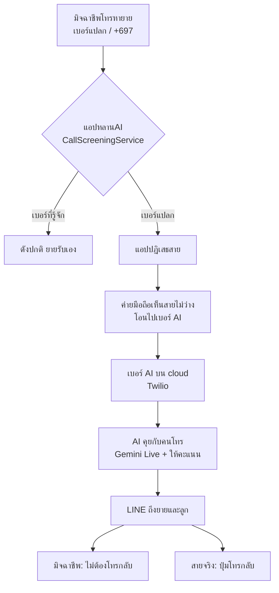

# แผน: โอนสายเบอร์แปลกให้ผู้ช่วย AI รับแทน (กันมิจฉาชีพ)

21 พ.ย. 2569 · ต่อจาก [elderly-ideation.md](elderly-ideation.md) (ไอเดีย I3 กันมิจฉาชีพ)

**ทำไมต้องทำเรื่องนี้:**
- ผู้เสียหายอายุ 60+ เป็นแค่ **8% ของคดีออนไลน์** แต่เสียเงิน **28.55% ของความเสียหายทั้งหมด** คือ 3,152 ล้านบาทใน 8 เดือนแรกของปี 2569 (ตำรวจไซเบอร์ · ดู [elderly-bangkok-data.md](../research/elderly-bangkok-data.md))
- ของที่มีในไทยตอนนี้ (Whoscall) ดูได้แค่เบอร์ ยังไม่มีใครคุยกับคนโทรแทนผู้สูงอายุ

---

## 1. Flow (อ่านแบบไวท์บอร์ด)

```
0. ตั้งค่าครั้งเดียว
   ลูกหลานลงแอป "หลานAI" ในมือถือยาย (Android)
   → แอปกดรหัสโอนสายตอนสายไม่ว่าง  **67*เบอร์AI#  ให้

1. มีคนโทรหายาย → แอปเช็กเบอร์ก่อนเครื่องดัง (CallScreeningService)
   ├─ เบอร์ที่รู้จัก (ลูก, หมอ) → ดังปกติ ยายรับเอง
   └─ เบอร์แปลก / ขึ้นต้น +697 +698 → ไปข้อ 2

2. แอปกด "ปฏิเสธสาย" ให้อัตโนมัติ
   → ยายไม่ได้ยินเสียงเรียกเข้า ไม่ต้องคุยกับมิจฉาชีพ

3. ค่ายมือถือ (AIS / True / dtac) เห็นว่า "สายไม่ว่าง"
   → โอนสายไปเบอร์ผู้ช่วย AI ที่ตั้งไว้ในข้อ 0
   ** ค่ายเป็นคนโอน แอปไม่ได้โทรออกเอง **

4. ผู้ช่วย AI รับสายแทนยาย
   AI:     "สวัสดีค่ะ ดิฉันเป็นผู้ช่วยของคุณแดง ติดต่อเรื่องอะไรคะ"
   คนโทร:  "ผมเป็นตำรวจ คุณแดงมีคดีฟอกเงิน ต้องโอนเงินด่วน"
   → AI ให้คะแนนว่าน่าจะเป็นมิจฉาชีพแค่ไหน

5. LINE เด้งหายายและลูก
   ├─ ⚠️ "มิจฉาชีพอ้างเป็นตำรวจ ไม่ต้องโทรกลับนะคะ"
   └─ ✅ "หมอจาก ศบส. โทรมานัดตรวจ กดโทรกลับได้เลย"
```



### คนโทรจะได้ยินอะไร

| คนโทรได้ยิน | เบื้องหลัง |
|---|---|
| กดโทร → "ตู๊ด... ตู๊ด..." | แอปปฏิเสธสายภายในไม่ถึง 1 วินาที ค่ายเห็นว่าสายไม่ว่าง แล้วโอนต่อ |
| อาจได้ยินตู๊ดต่ออีก 1–2 ครั้ง หรือเสียงประกาศของค่าย | **แต่ละค่ายไม่เหมือนกัน ต้องลองจริง** |
| "สวัสดีค่ะ ดิฉันเป็นผู้ช่วยของคุณแดง..." | AI รับสาย และบอกตรงๆ ว่าเป็นผู้ช่วย ไม่ปลอมเป็นยาย |

ค่ายเป็นคนโอนสายในเครือข่าย คนโทร**จึงไม่เห็นเบอร์ AI** และน่าจะไม่ได้ยินสัญญาณสายไม่ว่าง

---

## 2. ส่วนประกอบ

| # | ส่วน | ทำด้วย | ความเป็นไปได้ |
|---|---|---|---|
| ① | แอปคัดกรองและปฏิเสธสาย | Android `CallScreeningService` (role `ROLE_CALL_SCREENING`) → `CallResponse` ที่ตั้ง `setDisallowCall(true)` + `setRejectCall(true)` · ไม่ติด policy ของ Play | สูง |
| ② | ค่ายโอนสายต่อเมื่อเราปฏิเสธ | รหัส GSM สำหรับโอนเมื่อสายไม่ว่าง `**67*เบอร์#` ไม่ต้องติดต่อค่าย ทุกเบอร์ตั้งเองได้ | **ยังไม่รู้ ต้องลองกับซิมจริง** ⚠️ |
| ③ | เบอร์ AI | Twilio Programmable Voice (เบอร์โทรบน cloud ไม่ได้อยู่ในซิม) | สูง |
| ④ | AI คุยภาษาไทยในสาย | Twilio Media Streams (WebSocket, μ-law 8 kHz) ↔ backend แปลงเสียง ↔ Gemini Live API (PCM 16 kHz เข้า / 24 kHz ออก) | สูง |
| ⑤ | ให้คะแนนและแจ้งเตือน | Gemini สรุปและให้คะแนนตอนจบสาย → LINE Messaging API | สูง |

**เรื่องเบอร์ผู้โทร:** ถ้าโอนไปเบอร์ต่างประเทศ ปลายทางอาจไม่เห็นเบอร์จริงของคนโทร ให้แอปบนมือถือยายส่ง `เบอร์ + เวลา` ไปที่ backend ตั้งแต่ตอนคัดกรอง แล้วเอาไปจับคู่กับสายที่เข้าเบอร์ AI

---

## 3. เบอร์ AI: เบอร์ US หรือเบอร์ไทย

ค่าโทรขึ้นกับ**รหัสประเทศของเบอร์ปลายทาง** ไม่เกี่ยวกับว่าเซิร์ฟเวอร์ตั้งอยู่ที่ไหน

| | เบอร์ US (+1) | เบอร์ไทย (+66) |
|---|---|---|
| ซิมยายโอนไปนับเป็น | สายต่างประเทศ: แพง และค่ายอาจไม่ยอมโอน | สายในประเทศ: เรทปกติ |
| เอกสาร | ไม่ต้องใช้ แค่อัปเกรดบัญชีด้วยบัตรเครดิต (บัญชีทดลองฟรีจะมีเสียงประกาศก่อนทุกสาย) | ต้องยืนยันตัวตนตามกฎไทย: บุคคลใช้บัตรประชาชนไทย + หลักฐานที่อยู่ในไทย · บริษัทใช้หนังสือรับรอง + บัตรประชาชนผู้มีอำนาจ · ที่อยู่ต้องอยู่ในพื้นที่ของรหัสเบอร์ |
| ได้เบอร์เมื่อไหร่ | ทันที | ต้องรอตรวจ **Twilio ไม่บอกว่ากี่วัน** |
| ใช้ตอนไหน | **วันแข่ง** | **ใช้จริง** |

แหล่ง: [Twilio TH voice](https://www.twilio.com/en-us/guidelines/th/voice) · [Twilio TH regulatory](https://www.twilio.com/en-us/guidelines/th/regulatory)

Amazon Connect ขอเบอร์ +66 ได้ผ่าน AWS Support case ([docs](https://docs.aws.amazon.com/connect/latest/adminguide/phone-number-requirements.html)) และได้แต้มเพราะ AWS เป็นผู้สนับสนุนงาน แต่ต้องเช็กก่อนว่าฝั่ง AWS พูดไทย (TTS) ได้หรือไม่ ถ้าไม่ได้ ต้องส่งเสียงออกไปให้ Gemini ซึ่งยากกว่าทาง Twilio

---

## 4. ทดสอบก่อนลงแรง (ทำก่อนอย่างอื่น)

### Test A: ปฏิเสธสายแล้วค่ายโอนต่อไหม (ฟรี · 30 นาที)

ใช้มือถือ 3 เครื่อง: A = ยาย · B = ปลายทาง · C = คนโทร

1. ที่เครื่อง A กด `**67*เบอร์B#` (ยกเลิกด้วย `##67#`)
2. ให้เครื่อง C โทรหาเครื่อง A
3. ที่เครื่อง A กด "ปฏิเสธสาย"
4. จดผลตามตาราง แล้วทำซ้ำกับซิม**ทุกค่าย** (AIS / True / dtac · เติมเงินและรายเดือน)

| ค่าย (เครื่อง A) | ประเภท | เครื่อง B ดังไหม | C ได้ยินอะไร | ใช้เวลากี่วินาที |
|---|---|---|---|---|
| AIS | | | | |
| True | | | | |
| dtac | | | | |

### Test B: โอนไปเบอร์ Twilio US ได้ไหม

1. สมัคร Twilio → อัปเกรด (บัตรเครดิต) → ซื้อเบอร์ US 1 เบอร์ → ตั้ง webhook ให้เล่นเสียง "test"
2. ที่เครื่อง A กด `**67*+1xxxxxxxxxx#`
3. ให้อีกเครื่องโทรหาเครื่อง A แล้วกดปฏิเสธ
4. ดูใน Twilio Console ว่ามีสายเข้าไหม

**ถ้า Test A ไม่ผ่าน:** ทั้ง flow นี้ใช้ไม่ได้ → ถอยไปใช้แผน "เตือนก่อนรับสาย + AI ถามหลังวางสาย" ใน [elderly-ideation.md](elderly-ideation.md)

**ถ้า Test B ไม่ผ่าน:** ค่ายไม่ยอมโอนไปต่างประเทศ → วันแข่งใช้แผนสำรอง (ข้อ 6)

---

## 5. ไทม์ไลน์ถึงวันแข่ง (จ. 30 พ.ย.)

| วัน | งาน |
|---|---|
| ส. 21 – อา. 22 | **Test A + Test B** · ถ้าจะเอาเบอร์ไทยด้วย ให้ยื่นเอกสาร Twilio ไปพร้อมกันเลย เพื่อให้เริ่มตรวจวันจันทร์ |
| จ. 23 – พ. 25 | สร้าง ④ AI ในสาย + ⑤ LINE + ① แอปคัดกรอง โดยใช้เบอร์ US ไปก่อน |
| พฤ. 26 | **ตัดสินใจ:** ได้เบอร์ไทยไหม · ถ้าไม่ได้ ใช้เบอร์ US หรือแผนสำรอง |
| ศ. 27 | ทดสอบครบเส้น: โทรเข้า → ปฏิเสธ → โอน → AI รับ → LINE |
| ส. 28 – อา. 29 | ซ้อม demo + อัดวิดีโอสำรอง |
| จ. 30 | วันแข่ง |

## 6. แผนสำรองวันแข่ง

- ให้กรรมการโทรเข้าเบอร์ AI ตรงๆ (หรือผ่าน web dialer) แล้วเล่นบทมิจฉาชีพ → AI คุย ให้คะแนน แล้ว LINE เด้งบนจอ
- ช่วงโอนสาย (ข้อ 1–3) ใช้วิดีโอที่อัดไว้ตอนทำ Test A / B

---

## 7. ความเสี่ยงและข้อระวัง

| เรื่อง | แนวทาง |
|---|---|
| **PDPA:** เสียงของคนโทรเป็นข้อมูลส่วนบุคคล | AI บอกตั้งแต่ต้นสายว่าเป็นผู้ช่วย AI · ประมวลผลแล้วไม่เก็บเสียง · เก็บแค่สรุปและคะแนน · ก่อนใช้จริงให้ทนายดู |
| สายจริงที่ไม่ได้บันทึกเบอร์ เช่น โรงพยาบาลหรือไปรษณีย์ จะโดนส่งไป AI ด้วย | AI ถามธุระแล้วส่งสรุปพร้อมปุ่มโทรกลับ ยายไม่พลาดสายสำคัญ · ยายตั้ง whitelist เพิ่มได้ |
| ค่าโทรตอนโอนสาย | วันแข่งไม่เป็นไร · ใช้จริงต้องใช้เบอร์ไทย และเช็กโปรของซิมยาย |
| Gemini ฟังไทยพลาดเพราะเสียงสายโทรศัพท์คุณภาพต่ำ (8 kHz) | ลองกับเสียงสายจริงตั้งแต่ จ. 23 · ถ้าพลาดเยอะ ให้ AI ถามซ้ำหรือถามแบบปลายปิด |
| ผู้จัดบังคับให้ใช้ AWS ไหม | ถามผู้จัด · ถ้าบังคับ ให้ดูทาง Amazon Connect |

## 8. ทางอื่นที่ดูแล้วแต่ไม่เลือก (อ้างอิง)

| ทาง | ทำไมไม่เลือก |
|---|---|
| แอปดักฟังเสียงในสายโดยตรง | Android ไม่อนุญาต ต้องใช้ `CAPTURE_AUDIO_OUTPUT` ซึ่งให้เฉพาะแอประบบ |
| AccessibilityService + เปิดลำโพง | Play แบนตั้งแต่ปี 2022 และคุณภาพเสียงขึ้นกับรุ่นเครื่อง |
| อ่านไฟล์อัดเสียงสายในตัวเครื่อง (Samsung) | ใช้ได้แค่บางรุ่น และได้ผลหลังวางสายแล้ว · เก็บไว้เป็นทางเสริม |
| กล่องบลูทูธ HFP (Raspberry Pi / ESP32) ทำตัวเป็นชุดรับสายในรถ | ดักได้แบบ realtime แต่ต้องทำฮาร์ดแวร์ และตั้งค่ายาก · ใส่ไว้ใน roadmap |
| สายใน LINE / WhatsApp | แตะไม่ได้เลย (flow นี้ใช้ได้เฉพาะสายโทรศัพท์ปกติ) |

## 9. สิ่งที่ต้องตัดสินใจ / ต้องมีคนทำ

- [ ] ใครทำ Test A (ต้องมีซิมทั้ง 3 ค่าย)
- [ ] ใครสมัคร Twilio + ใส่บัตร (Game / โอ้)
- [ ] จะยื่นขอเบอร์ไทยด้วยไหม · ในนามบุคคลหรือบริษัท
- [ ] ถามผู้จัด: บังคับใช้ AWS ไหม · ใช้ของที่เตรียมก่อนวันแข่งได้ไหม · เปิดวิดีโอสำรองแล้วโดนหักคะแนนไหม
