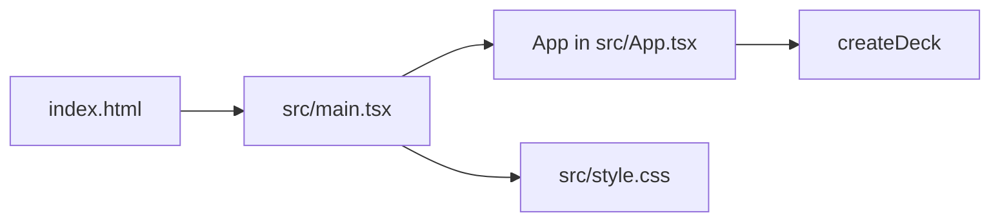
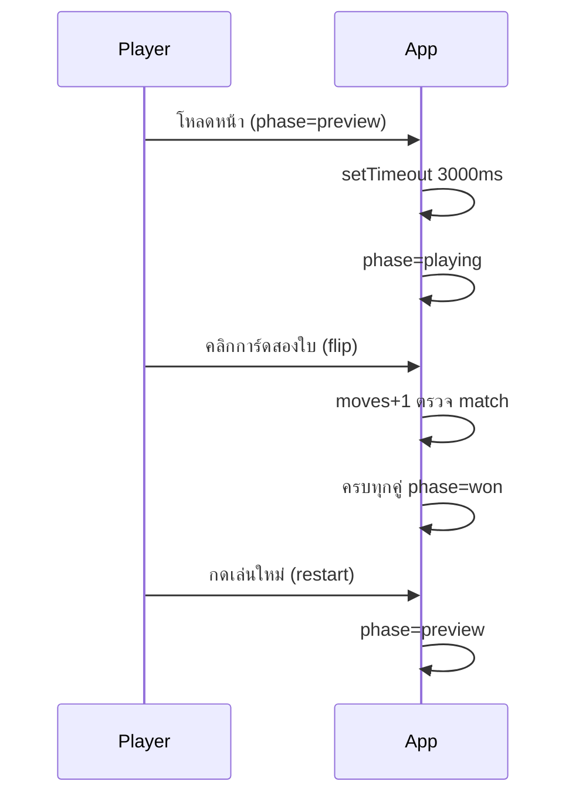

# Architecture

## Architecture Analysis

### System Overview
แอป single-page ฝั่ง client ล้วน: `index.html` โหลด `src/main.tsx` ซึ่ง render component `App` (`src/App.tsx`) ใน `StrictMode`. ไม่มี backend, router, state library หรือ storage.

### Architectural Style
Monolithic single-component SPA (React 18 + Vite). หลักฐาน: มี component เดียวคือ `App` และไฟล์ตรรกะเดียว. รายการ component ดู `component-inventory.md`.

### Component Relationships

Text fallback: `index.html` โหลด `main.tsx`; `main.tsx` render `App` และ import `style.css`; `App` เรียก `createDeck`.

### Data Flow
State ทั้งหมดอยู่ใน `App` ผ่าน `useState`: `cards`, `phase`, `selected`, `moves`, `locked` และ `useRef` `timer` (ตัวหน่วง mismatch). ไหลทางเดียว: เหตุการณ์คลิกการ์ด → `flip` → `setState` → render ใหม่. เฟส (`Phase = 'preview' | 'playing' | 'won'`):
- `preview` → `playing`: `useEffect` ตั้ง `setTimeout` 3000ms
- `playing` → `won`: ใน `flip` เมื่อ `updated.every(c => c.matched)`
- `won`/ใดๆ → `preview`: `restart` (สร้างเด็คใหม่ รีเซ็ต `moves`, `selected`, `locked`)
ไม่มีการอ่าน/เขียน `localStorage` หรือ storage อื่นทั้งโปรเจกต์ และไม่มีตัวจับเวลาเกม.

### Key Design Decisions
- ใช้ useState ภายใน component เดียว เรียบง่ายเหมาะกับขนาดนี้
- เด็คสร้างด้วย Fisher-Yates ใน `createDeck` (lazy initializer ของ `useState`)
- ล็อกการคลิกด้วย `locked` ระหว่างรอคว่ำการ์ดที่ไม่ตรงกัน

### Improvement Opportunities
- จุดเสียบตัวจับเวลา: เริ่มเมื่อ `phase` เป็น `playing`, หยุดเมื่อ `won`, รีเซ็ตใน `restart`
- จุดแสดงผล: `p.status` และ `div.win` ใน JSX ของ `App`
- เวลาที่ดีที่สุดต้องอ่าน/เขียน `localStorage` อย่างระมัดระวัง (ดู `code-quality-assessment.md`)

## Interaction Diagrams

Text fallback: โหลดหน้า → preview 3 วินาที → playing → ผู้เล่นเปิดการ์ดเป็นคู่ → เมื่อครบทุกคู่เป็น won → กดเล่นใหม่กลับ preview.
